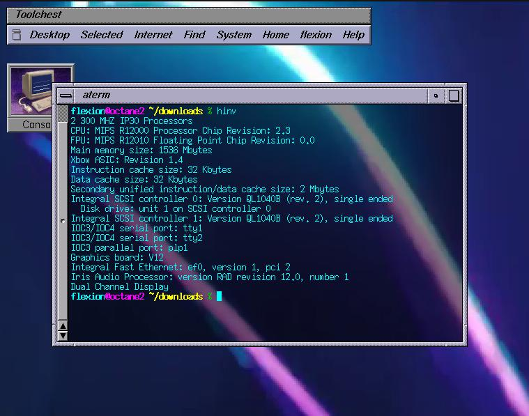

# aterm - for IRIX

Original aterm 1.0.1 source can be found at:
ftp://ftp.afterstep.org/apps/aterm/aterm-1.0.1.tar.bz2




## Modifications

- applied stropts patch
- applied dpy patch
- changed configure script (gcc only):

    LDFLAGS="$LDFLAGS -rdynamic"
    to 
    LDFLAGS="$LDFLAGS -Wl,--export-dynamic"

- rxvt.h: change DEFAULT_SHELL to /bin/tcsh
 if you want to override the shell start with: setenv SHELL /bin/bash && aterm

- command.c: changed DEFAULT_SHELL to query passwd file for users shell.


## Compile

use mipspro cc compiler

```sh
$ setenv CC cc
$ ./configure --without-afterimage-config
$ make
```

## Transparency

To start with (fake) transparency:

```sh
./aterm -tr -sh 50 -bg black -fg cyan
```

Example .auxchestrc launcher entry:

`"aterm" f.checkexec.sh.le "/usr/bin/aterm -tr -sh 50 -bg black -fg cyan -sl 1500"`


uses aterm built-in shading (no libAfterImage needed) when you configure with `--without-afterimage-config`

Requirements:

The X servers default visual must be TrueColor. 
Check with:

  ```sh
    $ xdpyinfo | grep -A4 "default visual"
  ```

  If it reports 8-bit PseudoColor, `-tr` still works but `-sh`/`-tint`
  will have no effect. Start Xsgi with a 24-bit TrueColor default visual,
  e.g. add `-depth 24 -class TrueColor` to the server line in
  /var/X11/xdm/Xservers.

